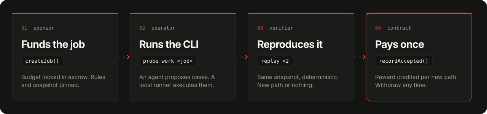

<p align="center">
  <a href="https://probecli.com"></a>
</p>

<p align="center">
  <a href="https://probecli.com"></a>
  <a href="https://verifier.probecli.com"></a>
  <a href="https://robinhoodchain.blockscout.com/address/0x75a7af44fe0117b1f5ff11eddad11fe1e0d34189"></a>
  <a href="https://github.com/probecli/probe"></a>
  <a href="https://x.com/probecli"></a>
</p>

<br>

**PROBE runs reproducible tests for Uniswap v4 hooks.** Hook teams fund a job on-chain. Operators run the `probe` CLI, where an AI agent proposes test cases against a pinned chain snapshot. A deterministic verifier replays every case, and the contract pays once for each new execution path it reproduces. Passing locally earns nothing; reproducing does.

<br>



<br>

### `probe work`, start to finish



<sub>Output from a real CLI run on a local test chain with a test token. Mainnet jobs pay in the token the sponsor funds.</sub>

<br>

### Run it

```shell
git clone https://github.com/probecli/probe && cd probe/protocol
npm install && npm link        # Node 22.18+ and Foundry
probe init                     # your operator key; rewards go to its address
probe jobs                     # what's funded on the live verifier
probe work <job>
```

### Live

| | |
|---|---|
| Network | Robinhood Chain mainnet · chain `4663` |
| Contract | [`0x75a7af44fe0117b1f5ff11eddad11fe1e0d34189`](https://robinhoodchain.blockscout.com/address/0x75a7af44fe0117b1f5ff11eddad11fe1e0d34189) · source verified, exact match |
| Verifier | [`verifier.probecli.com`](https://verifier.probecli.com) · `0xd3c3…d746`, approved on-chain |
| Code | [`probecli/probe`](https://github.com/probecli/probe): contract, verifier, CLI, job specs |

<br>

<p align="center">
  <sub><a href="https://probecli.com">probecli.com</a> · <a href="https://probecli.com/operators">Earn as an operator</a> · <a href="https://probecli.com/teams">Fund a job</a> · <a href="https://x.com/probecli">@probecli</a></sub>
</p>
